# День 3: Выбор "мозга" под твоё железо 🖥️

Сегодня мы подключим ИИ-модель к Cline. У тебя три пути в зависимости от твоего железа. Выбери свой и следуй инструкциям.

---

## 📊 Определи свой путь

### Как узнать, какой путь тебе подходит?

#### Шаг 1: Узнай, есть ли у тебя видеокарта (GPU)

**Windows:**

1. Нажми `Win + R`
2. Введи `dxdiag`
3. Нажми Enter
4. Перейди на вкладку **"Display"**
5. Смотри строку **"Name"** в разделе **"Device"**

**Или через Task Manager:**
1. Нажми `Ctrl + Shift + Esc`
2. Перейди на вкладку **"Performance"**
3. Слева найди **"GPU 0"**

**macOS:**

1. Нажми на яблоко в левом верхнем углу
2. Выбери **"About This Mac"**
3. Смотри строки **"Chip"** или **"Graphics"**

**Linux:**

Открой Terminal и введи:

```bash
# Для NVIDIA GPU
nvidia-smi

# Для всех GPU
lspci | grep -i vga
```

#### Шаг 2: Определи объём видеопамяти (VRAM)

**Windows (NVIDIA):**
```powershell
# Открой PowerShell и введи:
nvidia-smi --query-gpu=memory.total --format=csv
```

**Или через NVIDIA Control Panel:**
1. Правый клик на рабочем столе → **NVIDIA Control Panel**
2. Слева: **System Information**
3. Смотри **"Dedicated Video Memory"**

**macOS:**
- Apple Silicon (M1/M2/M3/M4): Видеопамять — это Unified Memory
  - 8GB RAM = ~4-5GB доступно для GPU
  - 16GB RAM = ~10-12GB доступно для GPU
  - 32GB RAM = ~20-24GB доступно для GPU

---

## 🎯 Выбери свой уровень

Три уровня доступа — Cline работает с любым из них:

| Уровень | Железо | «Мозг» | Почему так |
|---------|--------|--------|------------|
| 🟢 **Путь 1: CPU + бесплатный API** | Любой ПК + интернет | Groq `openai/gpt-oss-20b` | Бесплатно, быстро, не грузит систему |
| 🟡 **Путь 2: 4GB GPU + Ollama** | Видеокарта 4-6GB VRAM | `qwen3.5:2b` (запасной: `qwen3:4b`) | Локально, приватно, оффлайн |
| 🔴 **Путь 3: 16GB GPU + Ollama** | Видеокарта 16GB+ VRAM / Mac 16GB+ RAM | `gpt-oss:20b` (ещё: `gemma4:12b`, `qwen3:14b`) | Мощно, качественно, локально |

*Проверено: 2026-10-24 (модели — ollama.com и console.groq.com). Пересматриваем ежеквартально.*

Чтобы понять, какой у тебя уровень, узнай свою видеокарту и объём видеопамяти (VRAM).

---

# 🟢 ПУТЬ 1: CPU + бесплатный API (Groq)

**Для кого:** Нет видеокарты, старый ноутбук, или просто хочешь попробовать без установки.

**Время настройки:** 10-15 минут
**Стоимость:** Бесплатно (с лимитами)
**Требования:** Стабильный интернет

---

## Вариант 1A: Groq API (Рекомендуется)

### Что такое Groq?

**Groq** — это платформа для супер-быстрого запуска ИИ-моделей. Их особеность — невероятная скорость генерации текста.

**Почему Groq?**
- 🆓 Бесплатный tier с щедрыми лимитами
- ⚡ Очень быстрый (до 1000 токенов/сек)
- 🔧 Поддержка популярных моделей (GPT-OSS, Qwen)
- 🌐 API совместим с OpenAI форматом
- 🤝 В Cline есть нативный провайдер Groq — ключ вставляется в два клика

**Ограничения бесплатного tier** *(Проверено: 2026-10-24; лимиты периодически меняются — актуальные значения смотри на https://console.groq.com/docs/limits)*:
- Примерно 30 запросов/мин и 1000 запросов/день на модель
- Требуется интернет

> 🚨 **Приватность бесплатного API.** Запросы через Groq обрабатываются на их серверах, а не на твоём компьютере. Поэтому:
> - Никогда не вставляй в чат пароли, API-ключи и личные данные
> - Не отправляй файлы с секретами (например, `.env`)
> - Условия использования данных бесплатного tier меняются — перед работой сверься с политикой данных на console.groq.com
>
> Если позже будешь использовать OpenRouter: в настройках приватности отключи обучение на твоих данных для бесплатных моделей (Privacy → Enable/Disable training).

### Шаг 1: Регистрация на Groq

1. Открой браузер и перейди на: **https://console.groq.com**

2. Нажми **"Sign Up"** или **"Start for Free"**

3. Выбери способ регистрации:
   - **Вход через GitHub** (рекомендуется, если есть аккаунт)
   - **Вход через Google**
   - **Email/Password**

4. Если выбрал GitHub:
   - Авторизуйся на GitHub
   - Подтверди доступ к базовой информации профиля

5. Подтверди email (если регистрировался через email)

### Шаг 2: Создание API ключа

1. После входа ты попадёшь в **Groq Console**

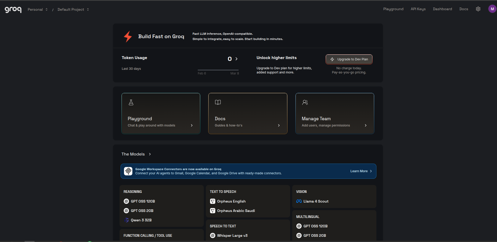

2. Нажми на **"API Keys"** в левом меню

3. Нажми кнопку **"Create API Key"**

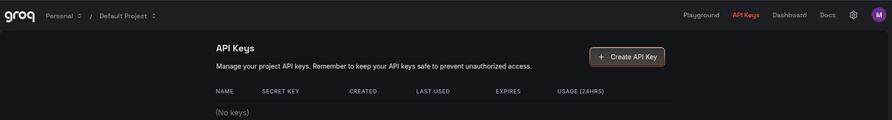

4. Введи имя ключа: `cline-course` (или любое другое)

5. Нажми **"Submit"** 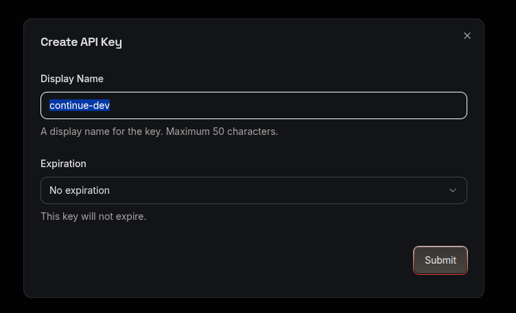

6. **ВАЖНО!** Скопируй ключ прямо сейчас!

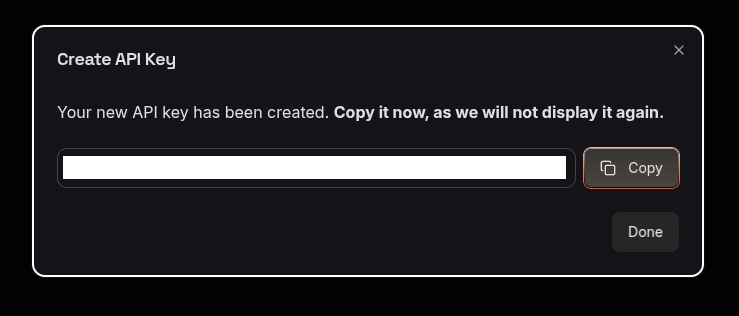

```text
⚠️ Ключ показывается только один раз! 
   Скопируй его и сохрани в надёжном месте.
   
   Не делится ключом с другими!
   Не коммить ключ в GitHub!
```

**Где сохранить ключ:**
- Менеджер паролей (1Password, Bitwarden, LastPass)
- Заметки (зашифрованные)
- Файл `.env` в проекте (добавь в `.gitignore`)

### Шаг 3: Подключение Groq к Cline

Всё делается прямо в интерфейсе Cline — никакие конфиги править не нужно.

#### 3.1. Открой настройки Cline

1. Открой VS Code и панель Cline (иконка слева в Activity Bar)
2. Нажми на шестерёнку ⚙️ (Settings)

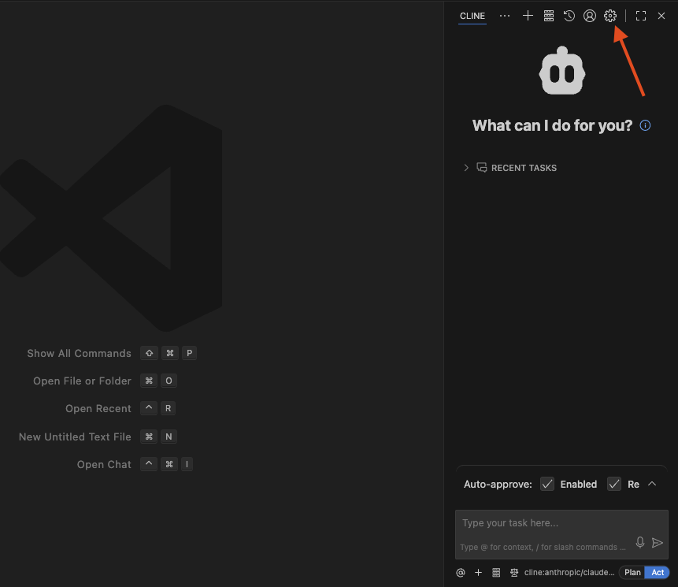

#### 3.2. Выбери провайдера

В выпадающем списке **API Provider** выбери **Groq**

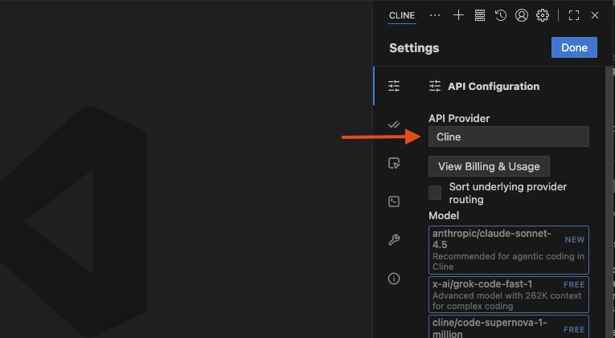

#### 3.3. Вставь API ключ

Вставь скопированный ключ в поле **Groq API Key**

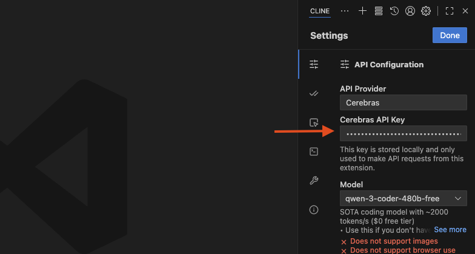

#### 3.4. Выбери модель

В списке **Model** выбери `openai/gpt-oss-20b`

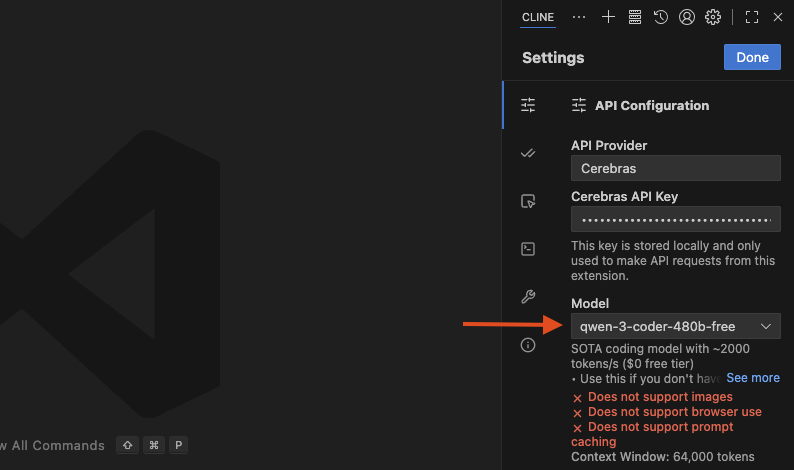

### Шаг 4: Проверка работы

1. Открой панель Cline
2. В поле ввода напиши: `Привет! Напиши "Hello World" на Python`
3. Нажми Enter или кнопку отправки

**✅ Если ИИ ответил — всё работает!**

### Рекомендуемые модели Groq *(Проверено: 2026-10-24)*

| Модель | Размер | Скорость | Качество | Для чего |
|--------|--------|----------|----------|----------|
| `openai/gpt-oss-20b` | 20B MoE | ⚡⚡⚡⚡⚡ | ⭐⭐⭐⭐⭐ | Основная: код, агентные задачи |
| `openai/gpt-oss-120b` | 120B MoE | ⚡⚡⚡ | ⭐⭐⭐⭐⭐ | Сложные задачи, сильные рассуждения |

**Рекомендация для кодинга:** `openai/gpt-oss-20b` — быстрее и бережнее расходует бесплатные лимиты.

[список доступных моделей в Groq: ](https://console.groq.com/docs/models)

---

## Вариант 1B: Google Gemini API (Альтернатива)

### Что такое Gemini?

**Gemini** — это ИИ-модель от Google. Доступна бесплатно через Google AI Studio.

**Почему Gemini?**
- 🆓 Бесплатный tier
- 🧠 Современная модель
- 📝 Большое контекстное окно (1M токенов)
- 🌐 Интеграция с Google сервисами

### Шаг 1: Регистрация

1. Перейди на: **https://aistudio.google.com**

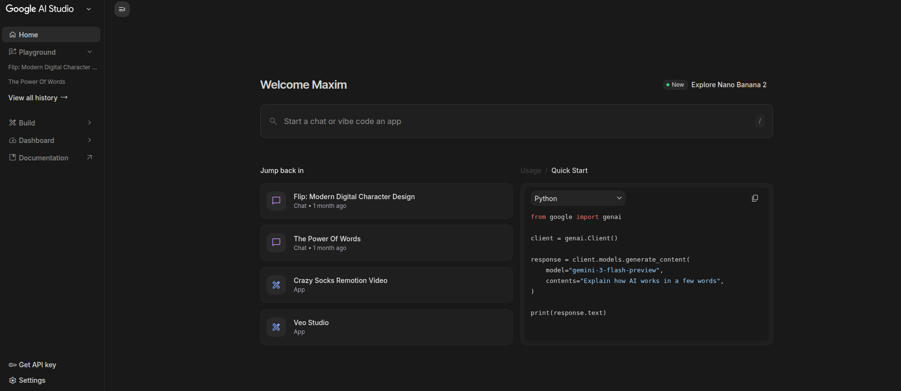

2. Нажми **"Get API key in Google AI Studio"**

3. Войди в Google аккаунт

4. Нажми **"Create API Key"**

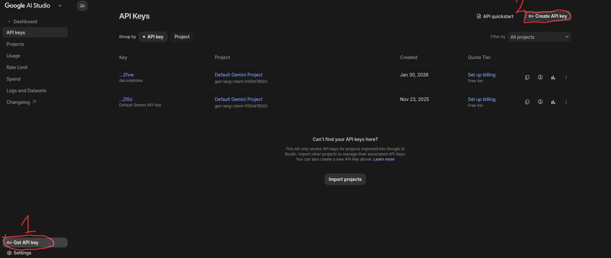

5. Выбери проект или создай новый

6. Скопируй API ключ

### Шаг 2: Подключение к Cline

#### Используйте VPN!!!

1. Открой настройки Cline (⚙️ в панели)
2. В **API Provider** выбери **Google Gemini**
3. Вставь ключ в поле **Gemini API Key**
4. В списке **Model** выбери `gemini-3.1-flash-lite-preview`

> 💡 Если этой модели нет в списке — выбери любую модель вида `gemini-...-flash...` (самая быстрая из доступных).

### Рекомендуемые модели Gemini *(Проверено: 2026-10-24)*

`gemini-3.1-flash-lite-preview`(Text, Image, Video, Audio, and PDF)

> 🚨 То же правило приватности, что и для Groq: запросы уходят в облако Google — не вставляй в чат секреты и личные данные.

---

# 🟡 ПУТЬ 2: 4GB VRAM (Ollama + Qwen)

**Для кого:** Есть видеокарта с 4-6GB видеопамяти (GTX 1650, GTX 1060, RTX 3050 и т.д.)

**Время настройки:** 15-20 минут
**Стоимость:** Бесплатно навсегда
**Требования:** Видеокарта 4GB+ VRAM, 8GB+ RAM

---

## Что такое Ollama?

**Ollama** — это инструмент для запуска LLM моделей локально на твоём компьютере.

**Преимущества:**
- 🔒 Полная приватность (данные не покидают твой компьютер)
- 🆓 Бесплатно навсегда
- 📴 Работает оффлайн
- ⚙️ Простое управление моделями
- 🚀 Автоматическое использование GPU

**Модели для 4GB VRAM** *(Проверено: 2026-10-24)*:

| Модель | Размер | VRAM | Качество | Скорость |
|--------|--------|------|----------|----------|
| `qwen3.5:2b` | ~3GB | 3-4GB | ⭐⭐⭐⭐ | ⚡⚡⚡⚡ |
| `qwen3:4b` | ~2.5GB | 3-4GB | ⭐⭐⭐⭐ | ⚡⚡⚡ |

---

## Шаг 1: Установка Ollama

### 🪟 Windows

#### Вариант 1: Через установщик (рекомендуется)

1. Перейди на: **https://ollama.ai/download**

2. Нажми **"Download for Windows"**

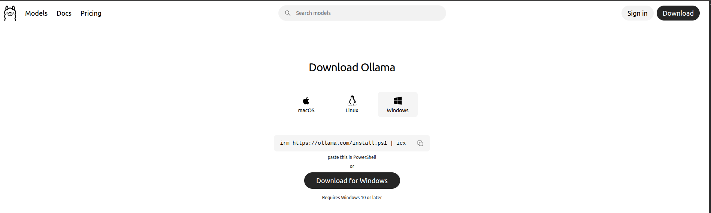

3. Скачается файл `OllamaSetup.exe`

4. Запусти установщик

5. Нажми **"Install"**

Видеоинструкция: https://www.youtube.com/watch?v=VBFndrvxpCI

6. Дождись установки (1-2 минуты)

7. Нажми **"Finish"**

**Ollama запустится автоматически и появится в трее (рядом с часами).**

#### Вариант 2: Через PowerShell

Открой PowerShell от имени администратора и введи:

```powershell
# Скачай и установи через winget (Windows 11/10)
winget install Ollama.Ollama
```

#### Проверка установки

Открой Command Prompt или PowerShell:

```cmd
ollama --version
```

**Должно вывести что-то вроде:**

```text
ollama version is 0.1.xx
```

### 🍎 macOS

#### Вариант 1: Через установщик

1. Перейди на: **https://ollama.ai/download**

2. Нажми **"Download for Mac"** (выберется правильная версия автоматически)

3. Скачается файл `Ollama-darwin.zip`

4. Распакуй архив (двойной клик)

5. Перетащи **Ollama** в папку **Applications**

6. Открой Ollama из Applications

7. Если появится предупреждение о безопасности:
   - Открой **System Settings** → **Privacy & Security**
   - Найди сообщение об Ollama
   - Нажми **"Open Anyway"**

#### Вариант 2: Через Homebrew

Если у тебя установлен Homebrew:

```bash
brew install ollama
```

#### Проверка установки

Открой Terminal:

```bash
ollama --version
```

### 🐧 Linux

Открой Terminal и введи:

```bash
# Скачай и запусти установочный скрипт
curl -fsSL https://ollama.ai/install.sh | sh
```

**Или пошагово для Ubuntu/Debian:**

```bash
# 1. Добавь ключ Ollama
curl -fsSL https://ollama.ai/install.sh | sh

# 2. Запусти сервис
sudo systemctl start ollama

# 3. Включи автозапуск
sudo systemctl enable ollama
```

**Для Arch Linux (AUR):**

```bash
yay -S ollama
```

#### Проверка установки

```bash
ollama --version
```

---

## Шаг 2: Настройка GPU (Важно!)

### Проверка обнаружения GPU

Открой Terminal/Command Prompt и введи (скачает модель ~3GB, если её ещё нет):

```bash
ollama run qwen3.5:2b --verbose
```

**Если GPU работает, ты увидишь:**

```text
loaded meta data with 22 key-value pairs and 322 tensors
...
GPU BLAS = 1
...
```

**Если GPU НЕ работает, ты увидишь:**

```text
GPU BLAS = 0
```

### Установка CUDA драйверов (NVIDIA, Windows/Linux)

Если GPU не обнаружен:

1. Проверь, установлены ли драйверы NVIDIA:
   
   **Windows:**
   ```cmd
   nvidia-smi
   ```
   
   **Linux:**
   ```bash
   nvidia-smi
   ```

2. Если команда не найдена, установи драйверы:
   
   **Windows:** Скачай с **https://www.nvidia.com/Download/index.aspx**
   
   **Linux (Ubuntu):**
   ```bash
   sudo apt install nvidia-driver-535  # или актуальную версию
   sudo reboot
   ```

### Для macOS (Apple Silicon)

Ollama автоматически использует Metal (GPU ускорение Apple Silicon).

**Проверь:**
```bash
# Запусти ollama и посмотри логи
OLLAMA_DEBUG=1 ollama run qwen3.5:2b
```

Должно быть `metal = 1` в логах.

---

## Шаг 3: Скачивание модели

### Выбор модели

Для 4GB VRAM рекомендуем:

`qwen3.5:2b`

| Если нужно | Модель |
|-----------|--------|
| Баланс скорости и качества (по умолчанию) | `qwen3.5:2b` |
| Есть 6GB+ VRAM — чуть умнее | `qwen3:4b` |

### Скачивание модели

Открой Terminal/Command Prompt:

```bash
# Рекомендуемая модель (2B)
ollama pull qwen3.5:2b
```

**Что происходит:**
1. Ollama скачивает модель (~3GB)
2. Автоматически оптимизирует под твоё железо
3. Сохраняет в кэш для быстрого запуска

**Время скачивания:** 5-15 минут (зависит от интернета)

### Альтернативные модели

```bash
# Плотнее и умнее (нужен запас VRAM)
ollama pull qwen3:4b
```

### Список установленных моделей

```bash
ollama list
```

**Пример вывода:**

```text
NAME                    ID              SIZE    MODIFIED
qwen3.5:2b              abc123def456    3.1 GB  2 hours ago
qwen3:4b                def789ghi012    2.5 GB  1 day ago
```

---

## Шаг 4: Подключение Ollama к Cline

Всё делается прямо в интерфейсе Cline — никакие конфиги править не нужно.

1. Убедись, что Ollama запущен (иконка в трее / меню-баре)
2. Открой VS Code и панель Cline
3. Нажми на шестерёнку ⚙️ (Settings)
4. В выпадающем списке **API Provider** выбери **Ollama**
5. В поле **Base URL** оставь `http://localhost:11434` (значение по умолчанию)
6. В списке **Model** выбери `qwen3.5:2b`

### Проверка работы

1. Открой панель Cline
2. Напиши: `Привет! Напиши функцию сложения на Python`
3. Нажми Enter

**✅ Если ИИ ответил — всё работает!**

---

## Шаг 5: Запуск Ollama при старте системы

### Windows

Ollama автоматически добавляется в автозапуск при установке.

**Проверь:**
1. Открой Task Manager: `Ctrl + Shift + Esc`
2. Перейди на вкладку **"Startup"**
3. Найди **"Ollama"** — статус должен быть **"Enabled"**

### macOS

```bash
# Создай LaunchAgent
ln -s /Applications/Ollama.app/Contents/Resources/ollama ~/Library/LaunchAgents/com.ollama.ollama.plist
```

Или просто добавь Ollama в **System Settings** → **General** → **Login Items**

### Linux

```bash
# Включи автозапуск сервиса
sudo systemctl enable ollama
```

---

# 🔴 ПУТЬ 3: 16GB+ VRAM (Ollama + GPT-OSS 20B)

**Для кого:** Мощная видеокарта (RTX 3060 12GB, RTX 4070, RTX 3090, RTX 4090) или Mac M1/M2/M3 с 16GB+ RAM

**Время настройки:** 20-30 минут
**Стоимость:** Бесплатно навсегда
**Требования:** 16GB+ VRAM или Apple Silicon 16GB+ RAM

---

## Установка Ollama

Следуй инструкциям из Пути 2 выше.

---

## Выбор модели

Для мощного железа рекомендуются *(Проверено: 2026-10-24)*:

| Модель | Размер | VRAM | Качество | Для чего |
|--------|--------|------|----------|----------|
| `gpt-oss:20b` | 14GB | 16GB+ | ⭐⭐⭐⭐⭐ | Основная: агентные задачи, tool calling |
| `gemma4:12b` | ~8GB | 8-16GB | ⭐⭐⭐⭐⭐ | Длинный контекст (256K), мультимодальная |
| `qwen3:14b` | 9.3GB | 12GB+ | ⭐⭐⭐⭐ | Универсальная |
| `qwen3-coder:30b` | 19GB | 16GB + часть в RAM | ⭐⭐⭐⭐⭐ | Максимальное качество кода |

**Рекомендация:** Начни с `gpt-oss:20b` — создана для агентной работы с инструментами.

---

## Скачивание моделей

```bash
# Основная модель
ollama pull gpt-oss:20b

# Легче и с длинным контекстом
ollama pull gemma4:12b

# Максимальное качество кода (частично уйдёт в RAM)
ollama pull qwen3-coder:30b
```

**Время скачивания:**
- `gpt-oss:20b`: 15-40 минут
- `gemma4:12b`: 10-20 минут
- `qwen3-coder:30b`: 20-50 минут

---

## Подключение Ollama к Cline

Всё делается прямо в интерфейсе Cline — никакие конфиги править не нужно.

1. Убедись, что Ollama запущен (иконка в трее / меню-баре)
2. Открой VS Code и панель Cline
3. Нажми на шестерёнку ⚙️ (Settings)
4. В выпадающем списке **API Provider** выбери **Ollama**
5. В поле **Base URL** оставь `http://localhost:11434` (значение по умолчанию)
6. В списке **Model** выбери `gpt-oss:20b`

---

## Тестирование скорости

Создай файл `test_speed.py` и попроси ИИ оптимизировать:

```python
# Попроси ИИ оптимизировать этот код
def slow_function(n):
    result = []
    for i in range(n):
        for j in range(n):
            if i * j % 2 == 0:
                result.append(i * j)
    return result
```

**Сравни скорость генерации разных моделей:**
- GPT-OSS 20B: быстрая и агентная — оптимум для Cline
- Gemma 4 12B: быстрее скачивается, отлично держит длинный контекст
- Qwen3 Coder 30B: сильнее в коде, но медленнее (часть весов в RAM)

---

# 📊 Сравнение всех путей

| Критерий | Groq API | Ollama Qwen3.5 2B | Ollama GPT-OSS 20B |
|----------|----------|------------------|------------------|
| **Цена** | 🆓 Бесплатно (с лимитами) | 🆓 Бесплатно | 🆓 Бесплатно |
| **Приватность** | ⚠️ Данные в облаке | 🔒 Полная | 🔒 Полная |
| **Оффлайн** | ❌ Нет | ✅ Да | ✅ Да |
| **Скорость** | ⚡⚡⚡⚡⚡ Очень быстро | ⚡⚡⚡⚡ Быстро | ⚡⚡⚡ Средне |
| **Качество кода** | ⭐⭐⭐⭐⭐ Отличное | ⭐⭐⭐ Хорошее | ⭐⭐⭐⭐⭐ Отличное |
| **Требования** | Интернет | 4GB GPU | 16GB GPU |
| **Настройка** | Простой | Средний | Средний |

---

## 🎯 Миссия дня

**Артефакт:** файл `setup-check.txt`, созданный руками Cline в папке проекта.

1. Создай папку `vibe-coding` (если ещё нет) и открой её в VS Code: **File → Open Folder**
2. Открой панель Cline и напиши:

```text
Создай файл setup-check.txt с одной строкой текста: «Модель подключена, я работаю».
```

3. Cline покажет план и предложит создать файл — нажми **Approve** (одобрить)
4. Открой папку `vibe-coding` в проводнике и убедись, что файл появился

### Проверка миссии

- [ ] Модель ответила в панели Cline (значит, подключение работает)
- [ ] Файл `setup-check.txt` лежит в папке `vibe-coding`
- [ ] Ты сам нажал Approve — это было первое одобренное тобой действие агента

---

## Checklist дня ✅

### Путь 1 (Groq):
- [ ] Зарегистрировался на Groq Console
- [ ] Создал API ключ
- [ ] Сохранил ключ в надёжном месте
- [ ] Подключил к Cline
- [ ] Проверил работу (ИИ отвечает)

### Путь 2 (Ollama + Qwen):
- [ ] Установил Ollama
- [ ] Проверил работу GPU
- [ ] Скачал модель `qwen3.5:2b`
- [ ] Подключил к Cline
- [ ] Проверил работу (ИИ отвечает)

### Путь 3 (Ollama + GPT-OSS):
- [ ] Установил Ollama
- [ ] Проверил работу GPU
- [ ] Скачал модель `gpt-oss:20b` или `gemma4:12b`
- [ ] Подключил к Cline
- [ ] Проверил работу (ИИ отвечает)

---

## Частые проблемы

### ❌ "Groq API key invalid"

- Проверь, что ключ скопирован полностью (без пробелов)
- Создай новый ключ, если старый не работает
- Проверь, что ключ не просрочен

### ❌ "Ollama not found"

- Проверь, что Ollama запущен:
  - Windows: посмотри в трее
  - macOS: посмотри в Menu Bar
  - Linux: `systemctl status ollama`

### ❌ "Out of memory" при запуске модели

- Попробуй модель меньшего размера:
  - Вместо `gpt-oss:20b` → `gemma4:12b`
  - Всё ещё не хватает VRAM → вернись к Пути 2 (`qwen3.5:2b`)
- Закрой другие приложения, использующие GPU

### ❌ Медленная генерация на GPU

- Проверь, что GPU используется:
  ```bash
  # При генерации должно быть видно использование GPU
  nvidia-smi  # в другом терминале
  ```
- Если GPU не используется, переустанови драйверы NVIDIA

---

## Что дальше?

**Завтра (День 4):** Мы пройдём первый полный цикл агента: сформулируешь результат, дашь контекст, делегируешь задачу Cline, посмотришь diff, проверишь запуск и научишься откатывать неудачные правки.

**Домашнее задание:**
- Поэкспериментируй с ИИ — задай разные вопросы
- Попробуй попросить объяснить что-то простое
- Запиши, какие вопросы работают хорошо, а какие — нет

---

📚 [На предыдущий день ←](./Day_2.md) | [На следующий день →](./Day_4.md)
