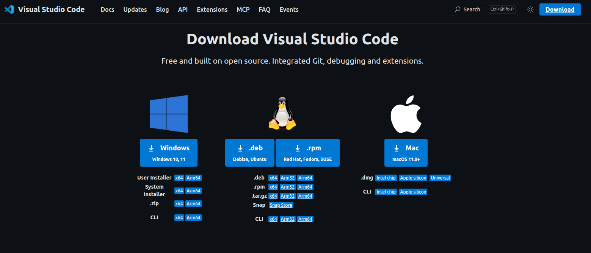
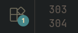
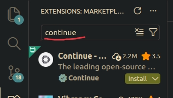
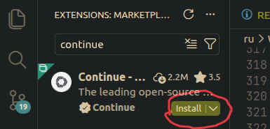
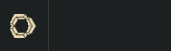
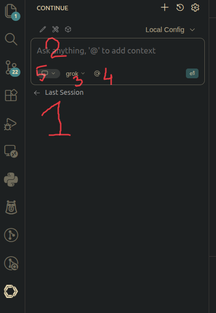

# День 2: Быстрая установка 🛠️

**Трек:** 👨‍💻 Программист | **Время:** 10 минут

---

## ⚡ TL;DR

```bash
# 1. Установи Continue.dev
code --install-extension Continue.continue

# 2. Открой Continue: Ctrl+L (Cmd+L на Mac)

# 3. Настрой модель (завтра в Day 3)
```

---

## 🔧 VS Code Extension

### Способ 1: CLI (рекомендуется)

```bash
code --install-extension Continue.continue
```

### Способ 2: Через VS Code

1. `Ctrl+Shift+X` (Extensions)
2. Поиск: `Continue`
3. Install от **Continue Dev**

---

## 📸 Интерфейс Continue

После установки (`Ctrl+L`):

```
┌─────────────────────────────┐
│  Continue Chat              │
├─────────────────────────────┤
│                             │
│  [История чата]             │
│                             │
├─────────────────────────────┤
│  [Модель: Select ▼]         │
│  [Контекст: Files ▼]        │
├─────────────────────────────┤
│  Введите промпт...          │
│  [📎] [🎤] [Send]           │
└─────────────────────────────┘
```

---

## ⚙️ config.json

Расположение:
- **Windows:** `%USERPROFILE%\.continue\config.json`
- **macOS/Linux:** `~/.continue/config.json`

Базовая структура:

```json
{
  "models": [
    {
      "title": "Model Name",
      "provider": "groq|ollama|openai",
      "model": "model-id",
      "apiKey": "YOUR_KEY" // или "${ENV_VAR}"
    }
  ],
  "contextProviders": [
    { "name": "codebase" },
    { "name": "files" },
    { "name": "open-files" }
  ]
}
```

---

## 🔑 Горячие клавиши

| Действие | Windows/Linux | macOS |
|----------|---------------|-------|
| Открыть Continue | `Ctrl+L` | `Cmd+L` |
| Новый чат | `Ctrl+Shift+L` | `Cmd+Shift+L` |
| Вставить выделенное в чат | `Ctrl+Shift+L` | `Cmd+Shift+L` |

---

## 📸 Скриншоты (если нужны)

| Скриншот | Путь |
|----------|------|
| VS Code download |  |
| Extensions icon |  |
| Find Continue |  |
| Install button |  |
| Continue icon |  |
| Continue panel |  |

---

## ✅ Проверка

1. Открой VS Code
2. `Ctrl+L` — должна открыться панель Continue
3. Если видишь "Select a model" — всё работает

---

## 🔧 Troubleshooting

| Проблема | Решение |
|----------|---------|
| Continue не открывается | Перезапусти VS Code |
| Extension не найден | Проверь Marketplace: `code --list-extensions \| grep -i continue` |
| Config не применяется | Удали `~/.continue` и открой Continue заново |

---

## Что дальше?

**Завтра (День 3):** Выбор модели — Groq (cloud) vs Ollama (local).

📚 [На предыдущий день ←](./Day_1.md) | [На следующий день →](./Day_3.md)
